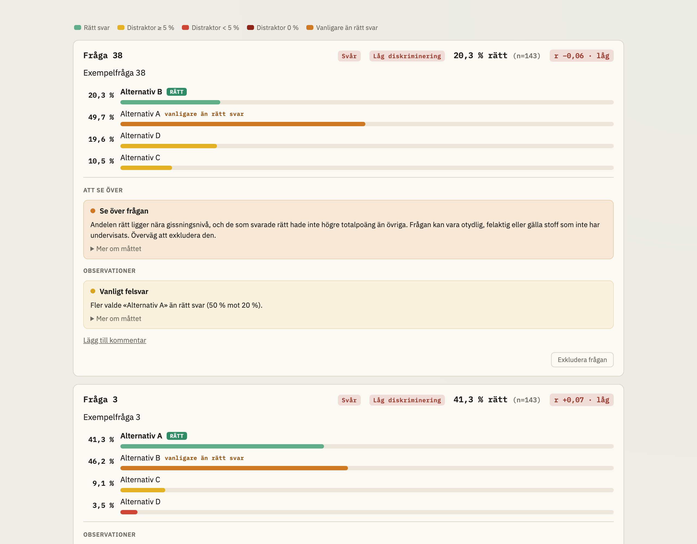
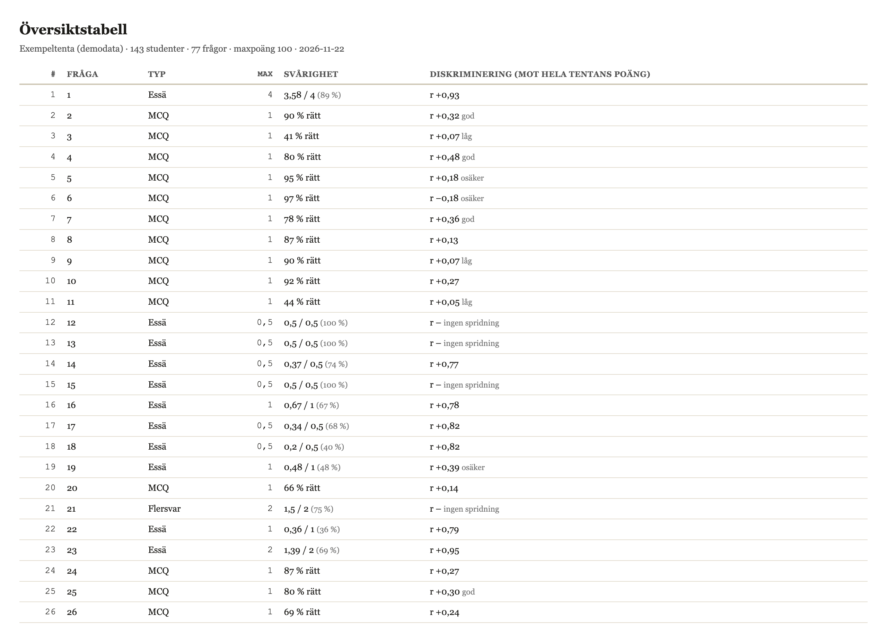

# Frågeluppen

**Ett webbverktyg för att analysera flervalstentor (MCQ) från Inspera – och för att bedöma och förbättra frågornas kvalitet.**

Frågeluppen visar, för varje fråga på en tenta, hur svaren fördelade sig, hur många som svarade rätt, och hur väl frågan *skiljer starka från svaga studenter* (diskriminering). Det används för att hitta frågor som behöver rättas om eller exkluderas, för att förbereda betygskollegiet, och för att ge frågekonstruktörer återkoppling.

---

## ▶ Så här kör du verktyget

Hela verktyget är **en enda fil**, `index.html`. Du behöver inte installera något eller titta på någon annan fil.

1. Klicka på **[`index.html`](index.html)** här ovanför i fillistan.
2. Klicka på **nedladdningsknappen** (ikonen med en pil, "Download raw file", uppe till höger i filvyn).
3. **Öppna den nedladdade filen** i en webbläsare (dubbelklicka på den, eller dra den till ett webbläsarfönster).

> Vill du hellre ha allt på en gång: klicka på den gröna **Code**-knappen högst upp på repot → **Download ZIP**, packa upp, och öppna `index.html`.
>
> Steg 1 behöver internetuppkoppling för att verktyget ska kunna läsa PDF- och Excel-filer (biblioteken hämtas från nätet). Det gör också exporten Tentamensstatistik i steg 3.

---

## Tre steg

Verktyget används i tre steg, som väljs i raden överst. Vem som gör vilket steg bestämmer ni
själva. I Linköping gör kurssamordnaren steg 1 och examinatorn steg 2 och 3.

**1 Förbered filer.** Sidan öppnar här.

1. Släpp resultatfilerna (JSON) från Inspera, tentans PDF och taggfilen om den finns.
2. Kontrollera kvittot (tentans namn och antal studenter). Klicka sedan **Gå vidare till steg 2**,
   eller **Spara kombinerad datafil** om någon annan ska göra steg 2 och 3.
3. Gör samma sak en gång till när tentan är rättad, med nya filer från Inspera.

Datafilen innehåller bara den data verktyget behöver. Studenternas skrivna svar,
rättarnamn, tider, extratid och alla id tas bort, och kandidatnumren ersätts av löpnummer.
Insperas slutbetyg och totalpoäng följer med, så att rättningen kan kontrolleras. Filen är
minimerad, inte anonym, och ska behandlas som tentamaterial. Skicka den aldrig vidare till
temagrupperna.

**2 Hitta problemfrågor.** Välj datafilen, om du inte kom hit direkt från steg 1. Här står de
flervalsfrågor som statistiken pekar ut före betygssättningen. Går att göra innan essäfrågorna
är rättade. **Problemfrågor** sparar en sida till betygskollegiet.

**3 Skapa rapporter.** Alla frågor efter rättningen. Härifrån skapas Temarapporten (interaktiv
eller som PDF, för hela tentan eller för det filter som är valt), översiktstabellen och
tentamensstatistiken.

## För temagrupper: temarapporten

Examinatorn skickar en fil, `temarapport_….html`, som öppnas i webbläsaren. Den visar hur
tentans frågor fungerade och innehåller bara sammanräknade resultat.

- Filtrera på tema och klicka **Markera alla visade**, eller bocka för enskilda frågor.
- **Spara sida med valda frågor** ger en ny fil med bara de frågorna, att ge vidare till den
  som skrev dem. Den sidan fungerar likadant och kan delas upp igen.
- Överst står det som gäller flera frågor på samma sätt, till exempel hur många som var
  mycket lätta. Korten har en ruta bara när något gäller just den frågan.
- **Filtrera** på tema, frågetyp, svårighet, diskriminering och sådant att titta på. Siffran
  på varje knapp säger hur många frågor ett klick ger.
- **Alla frågetyper på en sida**, i tentans ordning: flervalsfrågor (MCQ) med svarsfördelning,
  essä- och flersvarsfrågor med medelpoäng, diskriminering och poängfördelning. Frågetyp väljs
  i filtret.
- **Översiktstabell**: en tabell med en rad per fråga att skriva ut eller skicka vidare. Den
  följer filtret.
- Har en fråga en svaghet i statistiken prövas den mot den mekaniska kontrollen ur
  **MCQ-lathunden**, och ett fynd visas när det är en trolig förklaring.
- Statistiken visar hur frågorna fungerade i studentgruppen. Den säger inget om huruvida en
  fråga ligger på rätt nivå i förhållande till kursplanen.

## Så här ser det ut

Skärmbilderna nedan är från en äldre version av verktyget och visar inte dagens tre steg:

Översikten över hela tentan, varje frågas svårighet och diskriminering, är numera exporten Översiktstabell:

*(Skärmbilderna visar syntetiska, avidentifierade data och en äldre version av verktyget.)*

---

## Vad verktyget gör

- Läser tentans **PDF** och ett eller flera **JSON-resultat** från Inspera, samt en valfri **Excel** med teman per fråga.
- Visar per fråga: **svarsfördelning** per alternativ, **andel rätt** (svårighet) och **diskriminering** (punkt-biseriell item–total-korrelation), med färgkodad distraktoranalys.
- Två vägar för examinatorn: **problemfrågor före betygssättning** (flervalsfrågorna, före rättningen av essäfrågorna) och **hela rapporten** (alla frågetyper på en sida efter rättning, med Översiktstabell inför betygskollegiet).
- Filtrering på tema, exkludering av trasiga frågor, och export till **Excel** och som **översiktstabell** att skriva ut.
- En fristående **Temarapport** att dela med temagrupperna: utan triage och åtgärdsförslag, med frågor att ställa sig där svaren följer ett mönster, och med möjlighet att bocka för frågor och spara en egen sida att ge vidare.
- **Justerbara gränser** för märkningarna Lätt och Svår och för god diskriminering, i en hopfälld inställningspanel, och G-gränsen i procent direkt på rapportsidan.
- En inbyggd **"? Hjälp"** förklarar hur måtten tolkas.

Allt körs lokalt i webbläsaren – **inga data laddas upp någonstans**.

---

## Vad jag har gjort

Frågeluppen är utvecklad av mig, **Kajsa Igelström**, för analys av läkarprogrammets MCQ-tentor. Mitt bidrag är den pedagogiska och psykometriska utformningen:

- **Vilka mått som är relevanta och hur de ska tolkas** – svårighet, item–total-diskriminering och distraktoreffektivitet – och hur de presenteras så att en examinator kan agera på dem.
- **Arbetsflödet** i tre steg (förbered filer, hitta problemfrågor före betygssättningen, skapa rapporter efter rättningen), och återkopplingen till frågekonstruktörer.
- **Kraven, besluten och granskningen** av vad som är korrekt (t.ex. hur diskriminering beräknas mot rätt kriterium, hur teman kopplas till frågor, vad som får delas vidare).

Kodimplementeringen är framtagen med AI-assisterad utveckling (Claude), utifrån min specifikation och löpande granskning. Utvecklingen har skett iterativt – se [`CHANGELOG.md`](CHANGELOG.md).

---

## Integritet

Verktyget bearbetar riktiga studentresultat lokalt i webbläsaren; ingenting laddas upp. Temarapporten, Problemfrågor och Översiktstabellen innehåller **endast aggregat** (antal per alternativ, n, diskriminering, teman) – aldrig enskilda kandidatsvar, identifierare eller rådata. Exempeltentan är en simulerad kohort som återger en riktig tentas statistik utan några riktiga svar eller frågetexter.

---

## Övriga filer (behövs inte för att köra verktyget)

| Fil | Vad det är |
|-----|-----------|
| [`index.html`](index.html) | **Hela verktyget.** Det enda du behöver för att köra det. |
| [`CHANGELOG.md`](CHANGELOG.md) | Utvecklingshistorik version för version. |
| [`docs/`](docs) | Skärmbilder till denna README. |
| [`CLAUDE.md`](CLAUDE.md) | Arbetsinstruktioner för vidareutveckling (AI-assisterad). |
| [`LICENSE`](LICENSE) | MIT-licens. |

## Licens

**Koden** har MIT-licens – se [LICENSE](LICENSE). Fri att använda, ändra och dela, så länge
upphovsrättsnotisen följer med.

**Texterna** (hjälptexter, frågorna i "Att fråga sig" samt råd och motiveringar ur
MCQ-lathunden) har [CC BY 4.0](https://creativecommons.org/licenses/by/4.0/deed.sv): fria att
använda, dela och bearbeta med angivande av källa (Kajsa Igelström, Linköpings universitet).

## Kontakt

Kajsa Igelström – för frågor, buggar och förslag.
